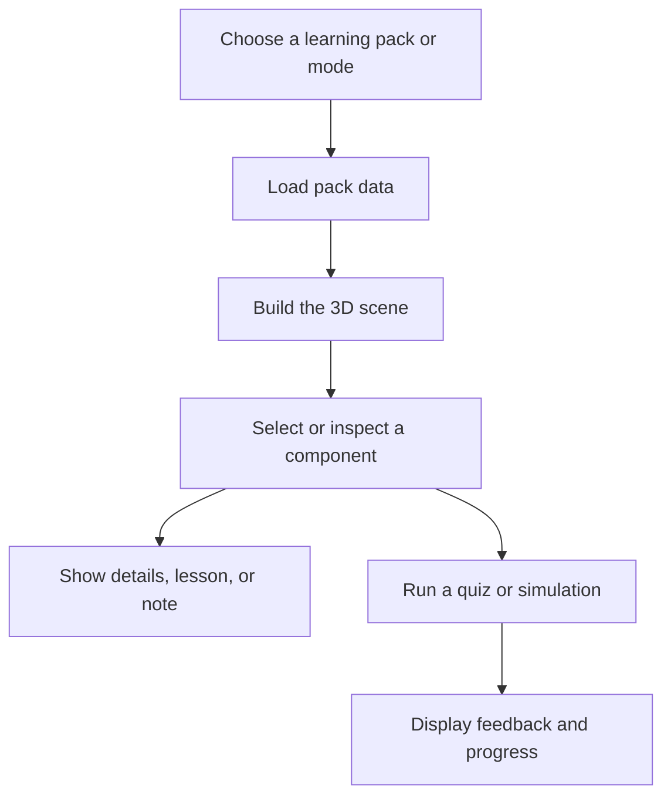

  <a href="https://github.com/Devputta/3D-PC">
    <strong>BOARDWALK · 3D PC HARDWARE EXPLORER</strong>
  </a>

<h1 align="center">Boardwalk</h1>

  <strong>Explore the hardware inside a PC. Follow the data across a network.</strong> 
  An interactive, browser-based 3D learning workbench for computer hardware, networking, and PC assembly.

  
  
  
  
  
  

  <a href="#quick-start">Quick start</a> ·
  <a href="#features">Features</a> ·
  <a href="#learning-packs">Learning packs</a> ·
  <a href="#architecture">Architecture</a> ·
  <a href="#testing">Testing</a> ·
  <a href="#deployment">Deployment</a>

Table of contents
- Why Boardwalk
- Features
- Learning packs
- How the 3D workbench works
- Quick start
- Tech stack
- Project structure
- Scripts
- Testing
- Keyboard shortcuts
- Privacy and local data
- Accessibility and responsive design
- Deployment
- Known limitations
- Roadmap
- Contributing
- License
Why Boardwalk?
Computer hardware and networking can be difficult to understand from static diagrams alone. Boardwalk turns those concepts into an interactive space where learners can inspect components, follow simulated flows, test their knowledge, and practise assembly decisions.

With Boardwalk, you can:
- Rotate and inspect a 3D motherboard and its components.
- Explode an assembly to reveal parts that are normally hidden.
- Follow simulated data, power, and network packet journeys.
- Learn hardware concepts through guided lessons and quizzes.
- Practise component placement and compatibility checks in build mode.
- Keep study notes attached to the relevant learning pack and component.
- Switch between English and Hindi.
Boardwalk is an educational simulator. Its visualisations and sample values are intended to explain concepts, not to replace manufacturer documentation or physical diagnostics.

Features
Explore a 3D motherboard
Inspect a desktop motherboard layout with representative components, including:
- Intel LGA1700 CPU socket
- Dual-channel DDR5 memory slots
- PCIe 5.0 x16 slot and GPU
- M.2 NVMe SSD and thermal block
- Voltage-regulator modules and power stages
- Platform Controller Hub (PCH)
- ATX and CPU power connectors
- CMOS battery, SATA ports, and rear I/O area
The scene uses procedural geometry, component labels, circuit-trace styling, lighting, and shadows to help make the layout easier to understand.
Explore networking equipment
Move through a simplified network containing a client workstation, managed switch, edge router, firewall, web server, and DNS resolver. Follow the request path and connect the equipment to the OSI model, from physical connectivity through application-layer protocols.
Explode and inspect assemblies
Use the explode control to separate parts and reveal the structure underneath. Components and subassemblies move along configured trajectories so learners can inspect the model from different angles.
Follow animated flows
Data flow
1. Storage to RAM
2. RAM to CPU caches
3. CPU to GPU over PCIe
4. GPU framebuffer to display
Power flow
- Follow representative +12 V, +5 V, and +3.3 V power paths.
- Inspect the role of ATX, CPU EPS, and PCIe auxiliary power connections.
Network packet flow
- Follow a client request through switching, routing, DNS resolution, and firewall inspection.
These are explanatory simulations rather than electrical or packet-level measurements of a real machine.
Learn in small steps
Lessons are organised to introduce a concept progressively. Depending on the lesson, you can explore an overview, ports and connections, a practical example, specifications, and a short knowledge check.
Test your understanding
- Select components directly in the 3D scene to answer spatial questions.
- Receive immediate feedback and a camera focus on the relevant component.
- Build custom quizzes around selected topics.
- Review question breakdowns and saved high scores.
Practise PC assembly
Build mode teaches compatibility concepts through rules such as:
- CPU socket compatibility
- RAM generation and notch alignment
- Power-supply budget checks
- Cooler and case-clearance checks
The simulator is a learning aid; always confirm actual compatibility using the component manufacturers' specifications before purchasing or assembling hardware.
Keep personal study notes
- Attach notes to a learning pack and a component or lesson.
- Keep notes separated by topic.
- Print notes as a study guide or export them as plain text.
- Store notes in browser storage so they remain available in that browser.
Use Boardwalk your way
- English and Hindi interface support
- Fullscreen 3D workbench
- Responsive canvas sizing
- Light interaction controls for camera movement and scene selection
- Keyboard shortcuts for common actions
Learning packs
Pack	What you can explore
PC Hardware	Motherboard components, CPU and memory placement, storage, power delivery, GPU connectivity, and assembly compatibility
Computer Networking	Workstations, switches, routers, firewalls, servers, DNS, and a guided view of network request paths

The exact lesson and component content is maintained in the project's pack data.
How the 3D workbench works
At a high level, Boardwalk connects learning content to a 3D scene:

The React interface manages the workbench state, while Three.js renders the scene and handles camera controls and object picking. The pack data supplies the educational content, and utility modules manage quiz logic and local note storage.
Quick start
Requirements
- Node.js 18 or newer
- npm 9 or newer
- A modern desktop or mobile browser with WebGL support
The exact Node.js version supported by your installed Vite version may be higher. If installation or startup reports a version requirement, use a currently supported Node.js LTS release.
Install and run
git clone https://github.com/Devputta/3D-PC.git
cd 3D-PC
npm install
npm run dev
Open the local URL printed by Vite in your terminal. The development server may choose a port automatically if its default port is already in use.
Check the project
npm run typecheck
npm test
npm run build
If a script is not available in the current package.json, check the Scripts section below and the package configuration before running it.
Tech stack
Area	Technology	Role
UI	React 19	Component-based application interface
Language	TypeScript 5.x	Typed application and learning data
3D rendering	Three.js	WebGL scene, camera controls, and object selection
Build tooling	Vite 8	Development server and production bundling
Testing	Vitest	Automated unit and integration tests
Persistence	Browser storage	Local study notes and selected learning progress

Project structure
3D-PC/
├── public/                 # Static assets, including fonts
├── src/
│   ├── components/         # Workbench UI and reusable interface components
│   ├── data/               # Hardware, assembly, and comparison data
│   ├── i18n/               # English and Hindi translations
│   ├── lib/                # Quiz and storage utilities
│   ├── packs/              # Hardware and networking learning packs
│   ├── scene/              # Three.js scene and layout logic
│   ├── App.tsx             # Main application component
│   └── main.tsx            # Application entry point
├── tests/                  # Automated test suites
├── ARCHITECTURE.md         # Architecture notes
├── CHANGELOG.md            # Project change history
├── CONTRIBUTING.md         # Contribution guide
├── DEPLOYMENT.md           # Deployment instructions
├── README.md               # Project overview and setup
├── TESTING.md              # Testing and QA guide
├── package.json            # Dependencies and scripts
├── tsconfig.json           # TypeScript configuration
└── vite.config.ts          # Vite configuration
This is a high-level overview; individual files may change as the project evolves.
Scripts
Run npm run to see the scripts defined in your local package.json. The project documentation describes these commands:
Command	Purpose
npm run dev	Start the local development server
npm run typecheck	Run TypeScript checks
npm test	Run the automated test suite
npm run build	Build the production assets

Testing
Run the automated tests with:
npm test
The test suite is intended to cover key behaviour, including:
- Study-note isolation and persistence behaviour
- Quiz scoring and answer evaluation
- Assembly compatibility rules
- English/Hindi translation consistency
- Simulated flow steps and scene layout data
- Comparison data integrity
For the full strategy and manual QA checklist, see [`TESTING.md`](TESTING.md).
Keyboard shortcuts
Shortcut	Action
Space	Play or pause the active flow simulation
Left Arrow / [	Previous lesson or flow step
Right Arrow / ]	Next lesson or flow step
F	Toggle fullscreen for the 3D canvas
Esc	Close a dialog, exit fullscreen, or clear selection
R	Reset the 3D camera
Ctrl + P / Cmd + P	Open the print view for study notes

Shortcut availability may depend on the active view.
Privacy and local data
Boardwalk's study notes and related browser-side state are stored locally in browser storage. This means:
- Data is associated with the browser and origin where you use the app.
- Clearing site data can remove locally stored notes and progress.
- Local browser storage is not a cloud backup or synchronisation service.
- Avoid entering passwords, private keys, or other sensitive information into study notes.
This README does not claim that the entire application makes no network requests; browser loading, fonts, deployment hosting, and other application resources may require network access.
Accessibility and responsive design
The project includes responsive canvas sizing, keyboard shortcuts, dialog interaction handling, and English/Hindi localisation. Please report any accessibility issue you encounter, including the browser and device where it occurs, so it can be reproduced and improved.
Deployment
Boardwalk is built with Vite and can be deployed to a static hosting provider that supports a Vite production build.
1. Push the project to GitHub.
2. Import the repository into your chosen hosting provider.
3. Set the build command to npm run build.
4. Set the publish/output directory to dist.
5. Deploy and test the hosted application on desktop and mobile.
For provider-specific steps and configuration, see [`DEPLOYMENT.md`](DEPLOYMENT.md).

Before deploying, confirm that the configured Node.js version satisfies the version requirements of the installed Vite release.
Known limitations
- The 3D models are educational representations and may not match every manufacturer's exact board layout or component revision.
- Simulated power, data, and network flows explain concepts; they do not measure a connected physical device.
- Assembly checks cover the rules implemented in the app and cannot guarantee compatibility for every real-world build.
- Notes and progress stored in browser storage may be lost when browser site data is cleared.
- Printed or exported study notes should be checked before sharing if they contain personal information.
Roadmap
Potential areas for future improvement include:
- Additional hardware and networking learning packs
- More component models and guided walkthroughs
- Expanded diagnostic scenarios and quiz questions
- Improved mobile interaction and accessibility
- More automated regression coverage
Please use the repository's Issues page to discuss ideas or report bugs: https://github.com/Devputta/3D-PC/issues
Contributing
Contributions, bug reports, and educational content proposals are welcome.
1. Fork the repository and create a focused branch.
2. Make a change that fits the project's existing architecture and style.
3. Run the relevant type checks and tests.
4. Update documentation when behaviour or setup changes.
5. Open a pull request describing the change and how it was verified.
Read [`CONTRIBUTING.md`](CONTRIBUTING.md) before submitting a change. Do not commit passwords, access tokens, private environment files, or other secrets.
Security reporting
Please do not publish sensitive vulnerability details in a public issue. Check the repository for SECURITY.md or the maintainer's preferred private reporting method before sharing details. Include reproduction steps and the affected version when possible.
License
Add the project's chosen license as a LICENSE file in the repository and update this section to match it. Do not assume that the project is MIT-licensed unless the repository's actual license file confirms that.

  <strong>Boardwalk</strong> 
  Learn the system. Trace the signal. Understand the build.

  <a href="https://github.com/Devputta/3D-PC">View the repository on GitHub</a>

